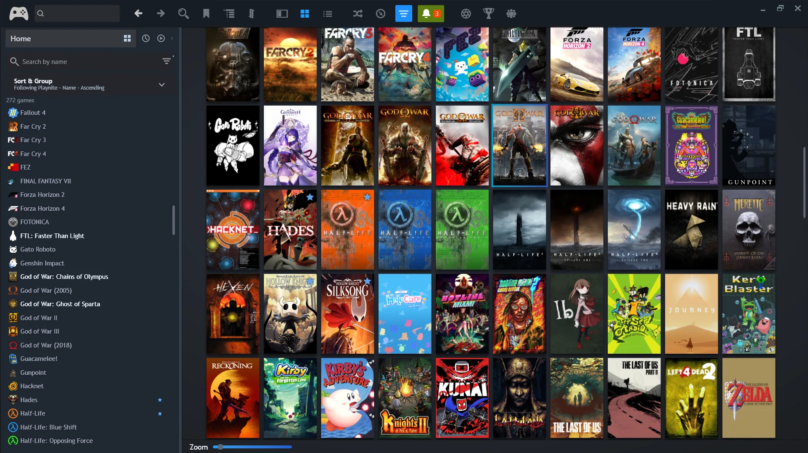
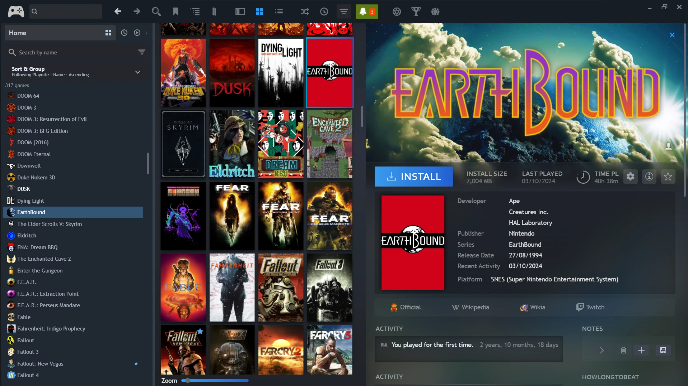
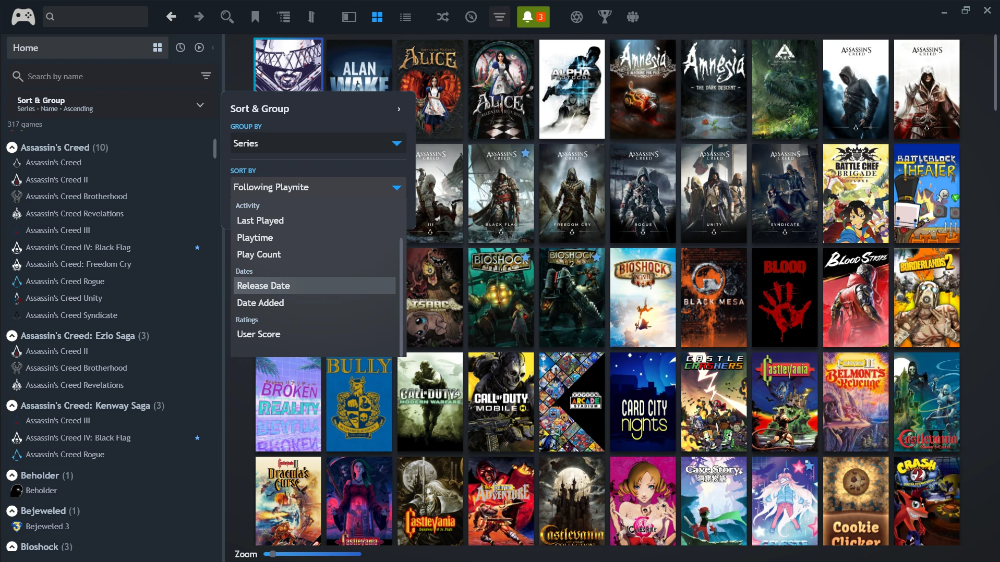
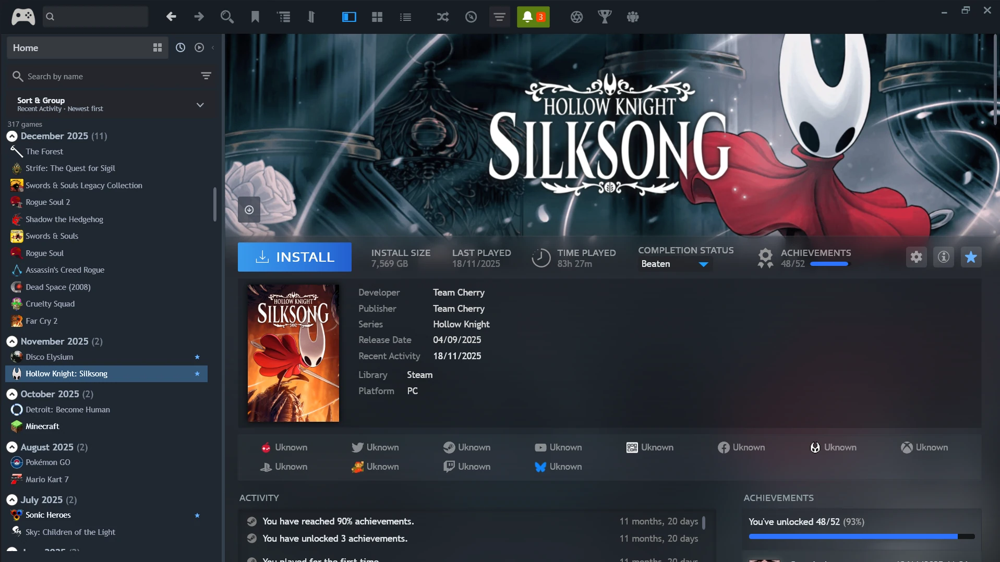
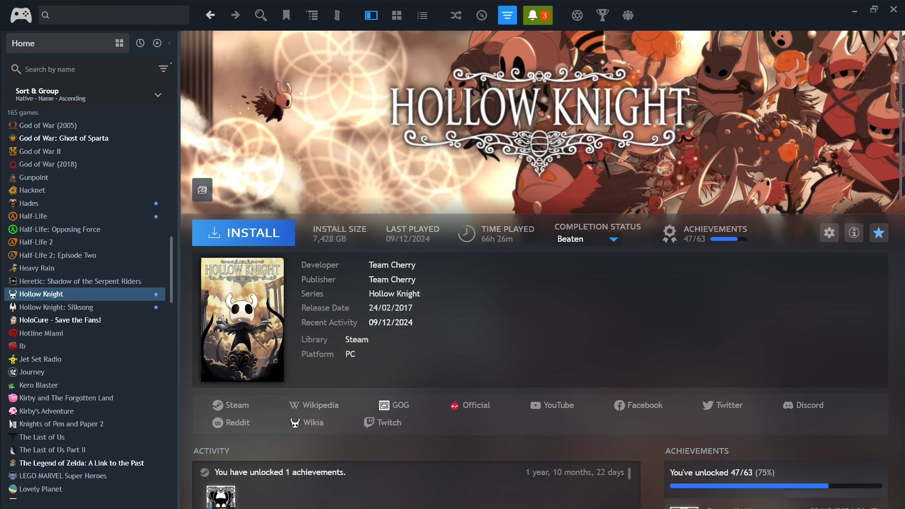

# Helium (charlo fork)

**A Steam-inspired library sidebar for Playnite Desktop, built around Playnite's existing views.**

Helium (charlo fork) is a modified version of [Helium](https://github.com/darklinkpower/Helium), based on the [KKCD fork](https://github.com/kushagr-m/Helium).

Its main addition is **Helium Navigator**, a customizable sidebar for browsing, organizing, and launching games alongside Playnite's Grid and Details views.

The idea is to bring some of Steam's library navigation into Playnite without replacing the library system underneath it.

**Latest release: v0.3.3 — Navigator Controls**

[Download](https://github.com/nocharlo/helium-charlo-fork/releases/tag/v0.3.3) · [Changelog](docs/CHANGELOG.md) · [Documentation](docs/README.md) · [Report an Issue](https://github.com/nocharlo/helium-charlo-fork/issues)

---

## Why I Started This

I've been using Playnite for a while, and one thing I kept missing from Steam was its library sidebar.

I wanted to have a compact list of games on the left while browsing covers or reading game details on the right. Being able to jump between games without constantly switching views is such a basic part of how I use Steam that I found myself missing it in Playnite.

I looked around for something similar, but nothing quite worked the way I wanted.

At the time, I was already using the KKCD fork of Helium, so I started experimenting with AI-assisted code to see if I could add my own Navigator to it.

The first working version was pretty rough, but it did what I wanted. I kept working on it, fixing things that bothered me, adding features, and gradually figuring out what kind of experience I wanted to build.

That's how this fork came about.

I'm sharing it because I figured I probably wasn't the only person who wanted something like this. It's still a personal project, but I'm working toward making it reliable enough for other people's libraries, too.

## Installation

**Requires Playnite 10 Desktop on Windows.**

Download both packages from the [latest release](https://github.com/nocharlo/helium-charlo-fork/releases/tag/v0.3.3):

- [Helium Theme (.pthm)](https://github.com/nocharlo/helium-charlo-fork/releases/download/v0.3.3/Helium-charlo-fork-v0.3.3.pthm)
- [Helium Navigator (.pext)](https://github.com/nocharlo/helium-charlo-fork/releases/download/v0.3.3/Helium-Navigator-v0.3.3.pext)

Open both packages with Playnite, confirm the installation, and restart the application. Then select **Helium (charlo fork) v0.3.3** under **Settings → Appearance → Desktop**.

The theme and Navigator extension must be on matching versions. The Navigator currently depends on the theme for its integrated layout.

For the Grid Details Panel experience, you'll also need [Details to Grid View Converter](https://playnite.link/addons.html#ThemesDetailsViewToGridViewConverter_ef8a7226-eedc-478d-a506-92ee6c088aa3).

If you're updating from an older version, back up your existing theme and Navigator settings first.

## Features

### Helium Navigator

A compact, resizable game list that works alongside Playnite's existing library views.

- **Search:** Find games directly from the sidebar without replacing Playnite's main search.
- **Sort & Group:** Organize games by series, platform, category, recent activity, and other metadata. Follow Playnite's current organization or configure the Navigator independently.
- **Recent Activity:** Browse recently played games using hybrid or detailed chronological groups.
- **Library Filters:** A floating panel with 27 native filter fields, searchable metadata, multiselection, and removable active-filter chips.
- **Game Indicators:** See installed status, favorites, and game icons directly in the list.
- **Context Menu:** Play, install, edit, and manage games without changing the Grid selection or scroll position.
- **Navigation:** Move between games and groups using the keyboard, and use Escape or the mouse's Back button to return from supported views and panels.
- **Customization:** Adjust sidebar width, visible sorting and grouping modes, filter layout, and other preferences.

The Navigator uses your existing Playnite library. It doesn't create a separate database or require changes to your metadata.

### Working With Playnite's Views

The Navigator is designed to complement Playnite's interface rather than replace it.

You can browse covers in **Grid View**, open the **Grid Details Panel**, or switch to **Full Details View** while keeping the Navigator available. Playnite's native List View remains accessible as well.

You can configure what happens when clicking a game in the Navigator or a cover in the Grid independently.

For example, I use the Navigator to open the Grid Details Panel and the covers to open Full Details View.

Selection and navigation are synchronized between supported views, including handling for scroll restoration and games moving between groups.

### Library Organization

The Navigator supports its own sorting and grouping preferences while retaining the option to follow Playnite's native organization.

Library Filters provides access to Playnite's existing filtering system from a separate floating panel. It supports multiple selections, searchable values, customizable fields, and persistent panel settings.

The **Ready to Play** shortcut, Recent Activity, and local Navigator search can be used alongside these controls.

More detailed information about the implementation and settings is available in the [documentation](docs/README.md).

## Screenshots

Click a screenshot to open it at full resolution.

| Hybrid Grid & Details | Sort & Group |
|:---:|:---:|
|  |  |
| **Recent Activity + Details** | **Native Full Details View** |
|  |  |

## Development

The project consists of two components:

- **Helium Theme:** The modified XAML/WPF theme and Navigator integration.
- **Helium Navigator:** A C# extension handling the sidebar, library organization, navigation, and settings.

The current codebase targets **.NET Framework 4.6.2** and **PlayniteSDK 6.19.0**.

The v0.3.3.1 candidate requires **Playnite 10.65 or newer** for its native per-game action execution API. The published v0.3.3 download links above remain available for older Playnite installations.

Development includes automated tests, regression checks, release validation, and testing in an isolated portable Playnite installation.

Technical documentation and development guidelines are available in [docs](docs/README.md) and [AGENTS.md](AGENTS.md).

### A Note on AI-Assisted Development

I don't have a traditional programming background. I started this project using Codex to help me write and modify code.

I handle the design, requirements, feature decisions, debugging, testing, and quality control, while much of the code has been written with AI assistance.

That doesn't mean development has been straightforward. Getting things to work reliably has involved a lot of iteration, troubleshooting, and correcting mistakes, including those introduced by AI-generated code. Some features have required multiple attempts, substantial rework, or changes in approach before reaching a stable implementation. AI assistance has made this project possible for me in my limited spare time, but it certainly hasn't eliminated the work involved.

I'm also using Helium as an opportunity to learn C# and better understand Playnite's architecture. I want to become increasingly capable of reading, evaluating, and reviewing the code independently, rather than relying entirely on the same tools that helped generate it. There's still a lot I don't know, and learning how the existing code works is a part of the process.

I think it's important to be upfront about all of this. AI-generated code can introduce problems that aren't immediately obvious, and I'm aware of the technical limitations and broader environmental and social concerns surrounding these tools.

I've been improving the project's testing and validation practices as it grows, but I don't consider that a replacement for experienced developers reviewing the code.

So, if you know Playnite or C# and spot something questionable, feel free to open an issue or suggest a better implementation. I'm always open to feedback and learning from people with more experience.

## Roadmap

Development is currently focused on stabilizing and improving the Navigator before moving on to larger changes to the Helium theme.

- **v0.3.4 — Architecture & Performance:** Refactor tightly coupled components, investigate performance bottlenecks, and improve reliability in larger libraries.
- **v0.4.0 — Adaptive Navigator (Exploratory):** Investigate making Navigator less dependent on Helium and potentially compatible with other Desktop themes.
- **v0.5.x — Theme Redesign (Proposed):** Revisit Full Details, Grid, Hybrid layouts, and explore a customizable genre and tag icon system.
- **Longer-term — Helium Home:** Explore a more complete library homepage with features such as Continue Playing and customizable game shelves.

These plans are subject to change as technical limitations and development priorities become clearer.

## Known Limitations

- The Grid Details Panel may briefly appear blank while Playnite rebuilds its view.
- Some mouse interactions and smaller window configurations still need broader testing.
- Compatibility with every extension and library setup hasn't been established.
- Custom per-game Actions in the v0.3.3.1 candidate use Playnite 10.65's public `StartGameAction` API. Earlier Playnite versions cannot load this candidate.
- Performance testing has included synthetic libraries with up to 2,500 games, but larger real libraries with artwork and store integrations need further testing.

I primarily develop and test on my own setup, so feedback from other configurations is particularly useful.

If something doesn't work as expected, please [open an issue](https://github.com/nocharlo/helium-charlo-fork/issues) with reproduction steps, screenshots, and relevant Playnite or library details.

## Credits

This project builds on work by people who made the original theme and the surrounding Playnite ecosystem possible.

- [Josef Nemec](https://github.com/JosefNemec) — Creator of Playnite.
- [Brandon Balderas (darklinkpower)](https://github.com/darklinkpower/Helium) — Creator of the original Helium theme.
- [Kush Mittal (KKCD)](https://github.com/kushagr-m/Helium) — Helium KKCD fork.
- **Playnite extension developers** — For the extensions and integrations supported by the theme.
- **charlo** — Fork maintenance, Navigator concept, design, specifications, testing, and AI-assisted development.

The original developers aren't responsible for bugs or changes introduced by this fork.

## License

This project is based on Helium and its KKCD fork. The inherited theme code is distributed under the **MIT License**, with the original attribution preserved in the repository's [license](license) file.

Helium (charlo fork) is an unofficial community project and is not affiliated with Playnite, Valve, or Steam.

---

*Made by someone who enjoys organizing their games as much as playing them.*
