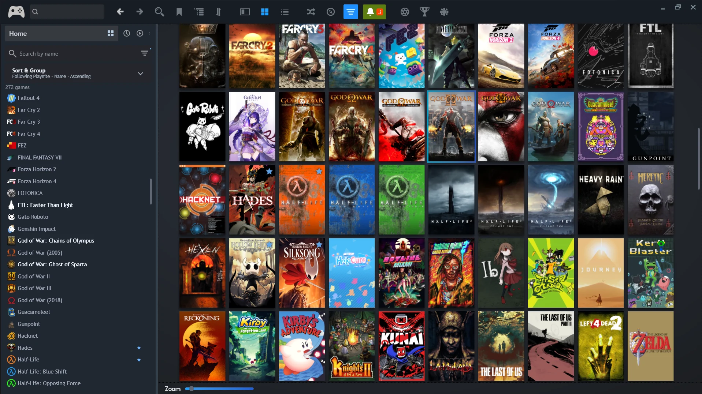
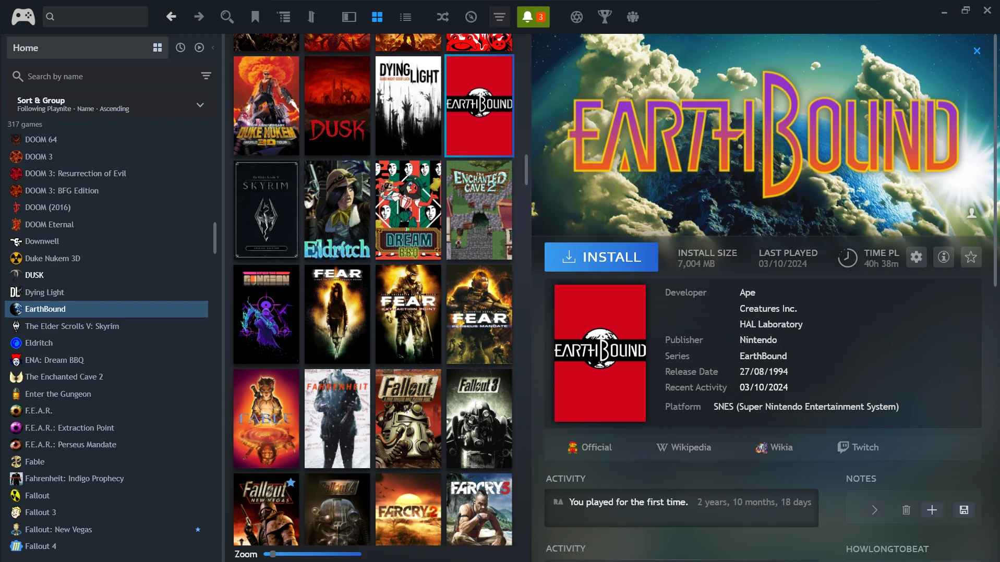
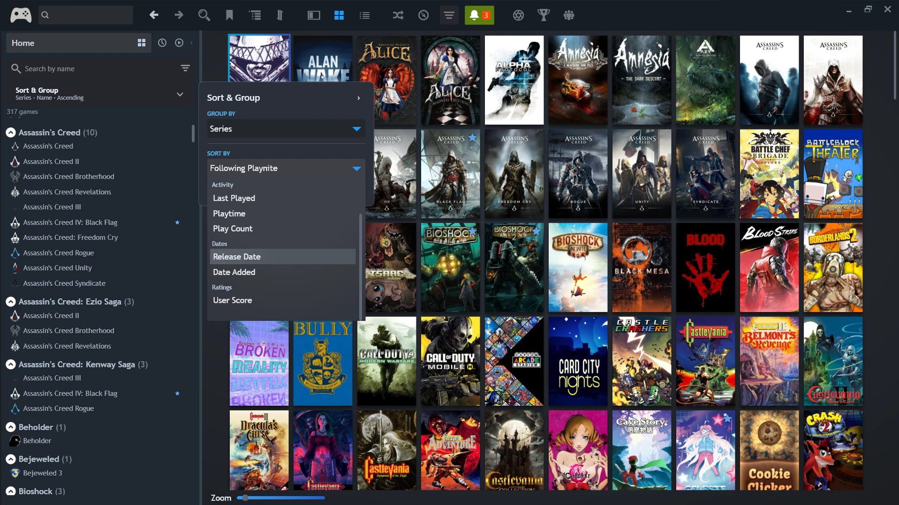
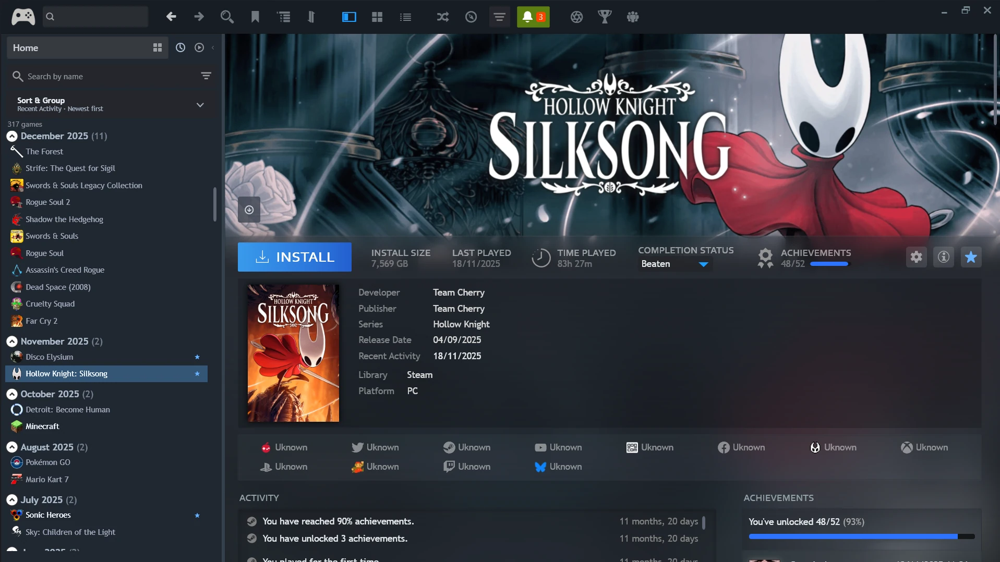
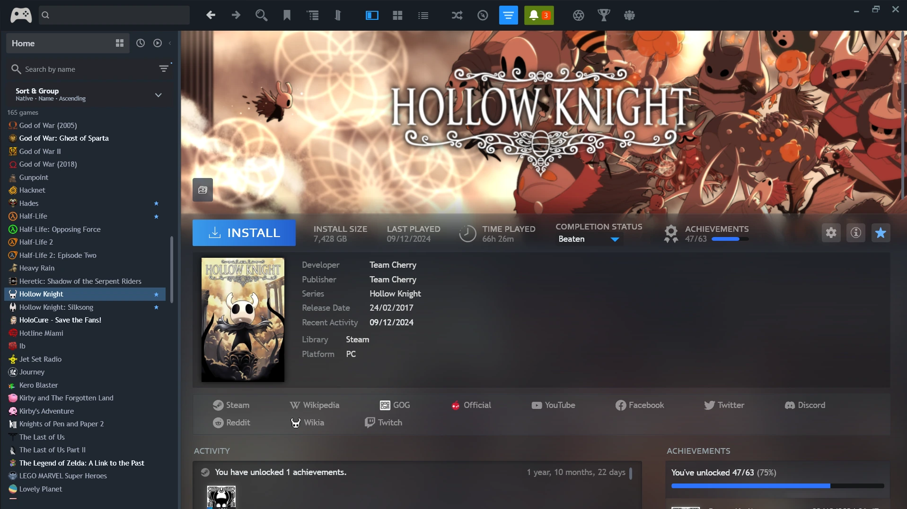

# Helium (charlo fork)

**A Steam-inspired library experience for Playnite Desktop.**

Helium (charlo fork) is a modified [Helium](https://github.com/darklinkpower/Helium) theme, based on the [KKCD fork](https://github.com/kushagr-m/Helium), with a custom game Navigator integrated into Playnite's native library views.

It brings Steam-style sidebar navigation to Playnite, combining a searchable game list with the Grid and Details views.

**Latest release: v0.3.2 — Library Filters & Native Organization**

[**Download**](https://github.com/nocharlo/helium-charlo-fork/releases/tag/v0.3.2) · [Changelog](docs/CHANGELOG.md) · [Report an Issue](https://github.com/nocharlo/helium-charlo-fork/issues)

---

## About

I've been using Playnite for a while, and one thing I've always missed from Steam is its library navigation.

I wanted a compact game list on the left while browsing covers or game details on the right, without constantly switching between views.

After looking around for something similar, I decided to experiment with AI-generated code using the Helium KKCD fork I already had installed.

Somehow, it worked.

This project is the result of that experiment. I'm sharing it in case anyone else has been looking for something similar.

## Features

- **Steam-style Navigator:** A searchable, collapsible sidebar with game icons, adjustable width, and persistent settings.
- **Native integration:** The Navigator uses Playnite's filtered games and shares the selection across supported library views.
- **Flexible navigation:** Use the Grid, Grid Details Panel, and Full Details View without losing your place.
- **Configurable clicks:** Choose independently how Navigator entries and Grid covers behave.
- **Smart selection:** Automatically reveal selected games inside collapsed Navigator groups.
- **Library indicators:** Favorite stars and distinct styling for installed and uninstalled games.
- **Improved stability:** Better preservation of scroll position, group expansion, and selection during library updates.
- **Recent Activity:** Browse games by last played date, with Hybrid and Detailed grouping modes and independent group expansion states.
- **Sort & Group:** Apply compatible sorting, sort direction, and grouping changes to Playnite, or turn off synchronization to organize the Navigator independently. Following Playnite uses the current native sort order. Customize which modes appear and their order.
- **Selection restoration:** Keep the selected game during supported view, sort, and grouping changes when it remains in the filtered results.

### Library Filters

The floating workspace exposes 27 native Playnite filter fields across **Library & Status**, **Classification**, **Game Information**, **Activity & History**, and **Ratings**. It switches between one, two, or three columns as the window width changes, and grows with expanded sections up to a scrollable height limit.

Search by field name or metadata value, select multiple metadata values, and load more choices in batches for long lists. Active conditions appear as chips you can remove individually. **Clear filters** clears conditions managed by the workspace. The Ready to Play shortcut and local Navigator search remain available.

Use **Navigator settings → Filters** to hide or reorder fields and groups. Hiding a field preserves any active condition and its chip.

The Navigator uses Playnite's existing library data. It doesn't maintain a separate database or modify your game metadata.

## Screenshots

Click any screenshot to view it at full resolution.

| Hybrid Grid & Details | Sort & Group |
|:---:|:---:|
|  |  |
| **Recent Activity + Details** | **Native Full Details View** |
|  |  |

## Installation

**Requires Playnite 10 Desktop on Windows.**

Download both components:

- [**Helium Theme (.pthm)**](https://github.com/nocharlo/helium-charlo-fork/releases/download/v0.3.2/Helium-charlo-fork-v0.3.2.pthm)
- [**Helium Navigator (.pext)**](https://github.com/nocharlo/helium-charlo-fork/releases/download/v0.3.2/Helium-Navigator-v0.3.2.pext)

Open each downloaded package with Playnite and confirm installation. Restart Playnite, then select **Helium (charlo fork) v0.3.2** under **Settings → Appearance → Desktop**.

**Use matching theme and extension versions.** The theme hosts the Navigator in the Desktop library. The Navigator is designed for this theme. Back up your existing configuration before updating.

The Grid Details Panel experience relies on [Details to Grid View Converter](https://playnite.link/addons.html#ThemesDetailsViewToGridViewConverter_ef8a7226-eedc-478d-a506-92ee6c088aa3).

## Development

Helium consists of two components:

- **Theme:** Modified XAML/WPF library layout.
- **Navigator:** C# extension handling game lists, selection, grouping, navigation, and preferences.

The project targets .NET Framework 4.6.2 and PlayniteSDK 6.11.0.

The repository includes automated tests and an isolated portable Playnite testing environment. See the [documentation index](docs/README.md) and [development guidelines](AGENTS.md) for details.

## A Note About Vibe Coding

**This project is entirely vibe-coded.**

I have no programming background, and I'm not going to pretend otherwise.

The custom implementation was generated with AI tools, mainly ChatGPT and Codex. My contribution has been the concept, design direction, requirements, testing, bug reports, and deciding what works and what doesn't.

I'm aware of the limitations of AI-generated code, including maintainability, reliability, and the environmental and social concerns surrounding AI development.

I don't consider this a substitute for programming expertise. It's an experiment in building something I wanted but couldn't create through conventional development.

**If you're a Playnite developer and see a better way to implement any of this, contributions and code reviews are very welcome.** I have no attachment to the AI-generated code itself.

## Roadmap

- **v0.3.3 — Contextual Actions (Planned):** Expands the Navigator's game context menu with useful actions such as Play/Install, Edit, Set Category, and Set Completion Status. Additional integrations, including Friendly Set Playtime, may be explored depending on compatibility and available public Playnite APIs.

### Beyond v0.3.x

- **Theme Evolution:** Further refinements to the Grid and Details views, with a stronger visual identity and improved consistency across the Helium experience.
- **Helium Home:** An experimental Steam-inspired library homepage featuring ideas such as Continue Playing and customizable game shelves. The earlier prototype remains archived, and its inclusion in a future release depends on technical feasibility and design quality.

**This roadmap represents the project's current direction, not a commitment to specific features or release dates.** Priorities and scope may change as development progresses.

## Known Limitations

- The details panel can briefly go blank while Playnite rebuilds its library view and restores the selection.
- Some unusual mouse interactions remain insufficiently tested.
- Uninstalled game names can appear too bright on hover.
- Narrow windows may feel cramped.
- Compatibility with every Playnite extension and configuration is not guaranteed.

Please report reproducible problems through [GitHub Issues](https://github.com/nocharlo/helium-charlo-fork/issues).

## Credits

- [Josef Nemec](https://github.com/JosefNemec) — Playnite.
- [Brandon Balderas (darklinkpower)](https://github.com/darklinkpower/Helium) — Original Helium theme.
- [Kush Mittal (KKCD)](https://github.com/kushagr-m/Helium) — Helium KKCD fork.
- **Playnite extension developers** — The integrations that make this setup possible.
- **charlo** — Concept, design direction, testing, and AI-assisted development coordination.

The original developers are not responsible for changes introduced by this fork.

## License

Based on Helium and its KKCD fork. The inherited theme code is distributed under the **MIT License**, with original attribution preserved in the repository's [license](license) file.

This is an unofficial community project, unaffiliated with Playnite, Valve, or Steam.

---

*Made by someone who spends an unreasonable amount of time organizing their game library instead of actually playing it.*
